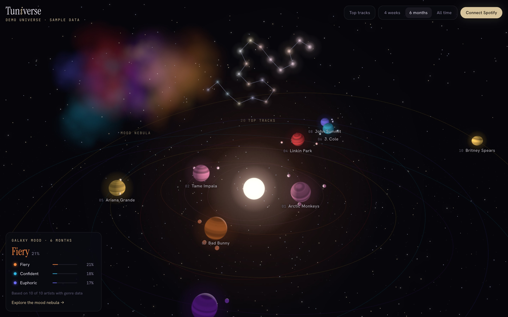
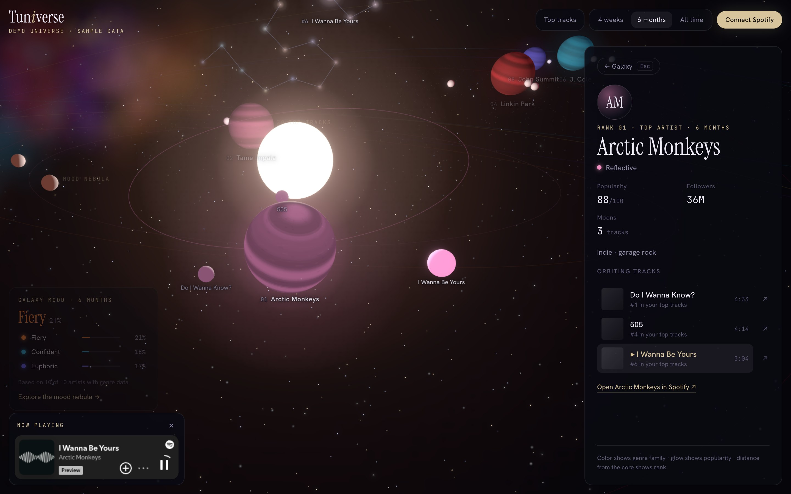
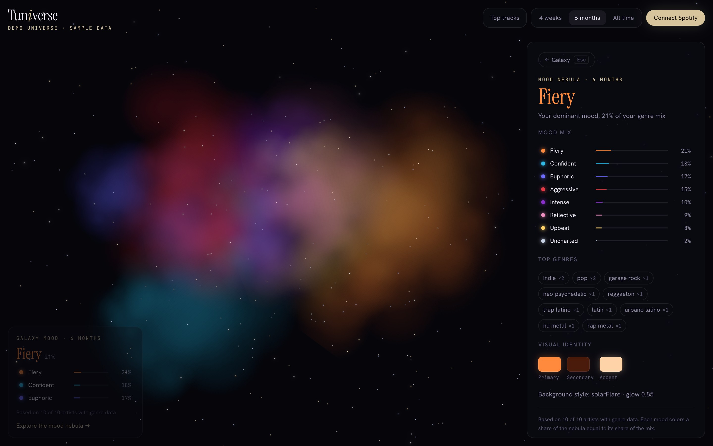
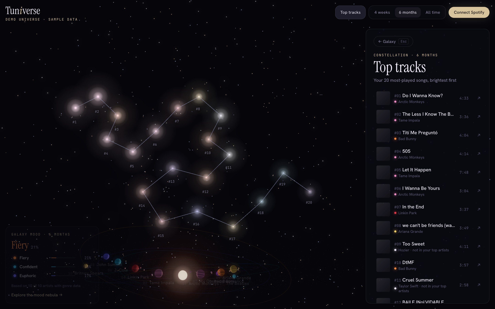
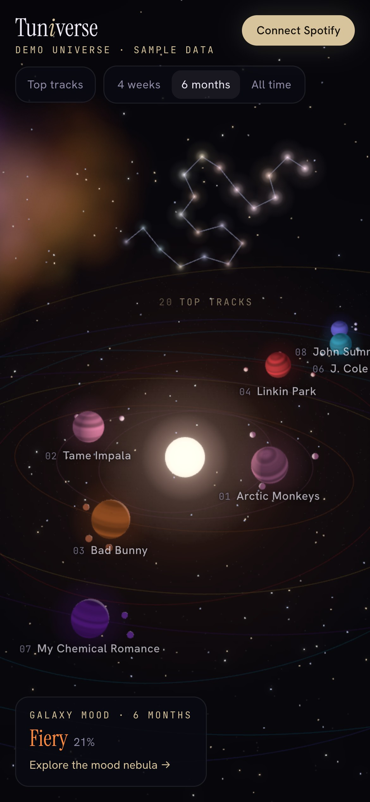
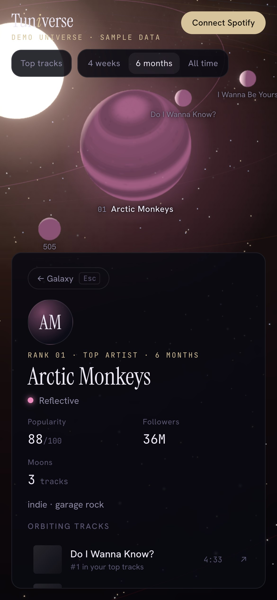

# Tuniverse 🌌🎶

Tuniverse is a full-stack music analytics and visualization application that transforms Spotify listening data into an interactive, space-themed experience. Inspired by Spotify Wrapped, Tuniverse allows users to explore their listening habits, moods, and trends at any point in time — not just once a year.

Your top artists become planets, your top tracks become their moons, and the genres you listen to set the colors and mood of your galaxy.

**Live:** https://tuniverse-blush.vercel.app (try the demo, no Spotify account needed)



## Current Status
Live. Spotify login is limited to allowlisted accounts while the app is in Spotify's development mode; everyone else can explore the demo galaxy.

## Features
**Frontend**
- A 3D galaxy built with React Three Fiber: your top artists are planets, banded and tinted by their mood, and their top tracks are moons
- A glowing core for you, which shifts to your dominant mood's color and opens your listening profile (moods, top genres, the decade your music comes from)
- Your top 20 tracks as a single constellation path, from #1 (brightest) to #20
- A mood nebula where each mood colors a share of the cloud equal to its share of your listening; the mood card doubles as a filter for the galaxy
- Three time ranges (4 weeks, 6 months, all time), with the camera flying between places and details shown only once you click
- A built-in Spotify player that keeps playing while you explore; songs start on their own on desktop, phones press play
- A demo galaxy for visitors who aren't on the Spotify allowlist, generated by the real backend pipeline
- Accessible: full keyboard navigation with focus management, screen-reader labels, a list view when WebGL isn't available, and layouts for phones in portrait and landscape

**Backend**
- Spotify OAuth (Authorization Code flow) with CSRF-protected `state`
- Per-user sessions via an HttpOnly cookie; tokens stay server-side (in-memory for dev, Redis in production)
- Transparent access-token refresh — on expiry and on 401, with a single retry
- Galaxy model: artists → planets (orbit, size, glow, genre color), tracks → moons
- Genre-based mood analysis with a visual identity (palette + background style) per mood
- Typed, slimmed responses for every endpoint, with `short_term` / `medium_term` / `long_term` time ranges
- Test suites for both halves: auth, sessions, token refresh and every endpoint on the backend; the galaxy, player, accessibility and fallbacks on the frontend

## Screenshots
<table>
  <tr>
    <td width="50%"></td>
    <td width="50%"></td>
  </tr>
  <tr>
    <td>Visit a planet to see the artist and their tracks, and play a song without leaving the galaxy</td>
    <td>The mood nebula: each mood colors its share of the cloud</td>
  </tr>
  <tr>
    <td width="50%"></td>
    <td width="50%" align="center">
      
      
    </td>
  </tr>
  <tr>
    <td>Your top 20 tracks as one constellation, from #1 to #20</td>
    <td>Phone layout</td>
  </tr>
</table>

## Tech Stack
**Frontend:** React 19, TypeScript, Vite, React Three Fiber (three.js, drei, postprocessing bloom), TanStack Query, React Router, plain CSS, Vitest + Testing Library, oxlint

**Backend:** Python 3.10+, FastAPI, Uvicorn, Pydantic, Redis, Spotify Web API, pytest

**Hosting:** Vercel (frontend, proxies `/api`), Render (API + Redis), GitHub Actions (keep-warm ping)

## Architecture
```
backend/
  main.py          App setup, CORS, error → HTTP mapping
  core/            Config, session store (memory / Redis), domain exceptions
  routers/         Thin HTTP layer: auth, spotify, health
  services/        spotify_auth (accounts API), spotify_client (Web API + refresh), spotify_service (use cases)
  transformers/    Raw Spotify payloads → models; genre → mood → visuals; artists → planets
  models/          Pydantic response models (the frontend contract)
  tests/
```

Routers never call Spotify directly. Services raise domain errors (`NotAuthenticatedError`, `SpotifyAPIError`, …) and `main.py` turns them into HTTP responses.

**Data modeling & API contracts**
- Every endpoint declares a `response_model`, so the OpenAPI docs at `/docs` are the frontend contract
- Responses are normalized for frontend consumption: snake_case, arrays of objects, raw Spotify fields removed
- Fields Spotify doesn't always return (popularity, followers, images) are optional

Spotify's Audio Features endpoints are deprecated for new apps (403), so Tuniverse builds on track metadata + artist genres instead of valence/energy/tempo.

## API (`/api/v1`)
| Endpoint | Description |
|---|---|
| `GET /health` | Health check |
| `GET /auth/login` | Redirects to Spotify login |
| `GET /auth/callback` | OAuth callback — creates the session, then redirects to the frontend (or returns JSON in backend-only mode) |
| `POST /auth/logout` | Ends the session |
| `GET /spotify/me` | Current user profile |
| `GET /spotify/top-artists` | Top artists (`time_range`, `limit` 1–50) |
| `GET /spotify/top-tracks` | Top tracks (`time_range`, `limit` 1–50) |
| `GET /spotify/galaxy` | Planets (artists) with moons (tracks) |
| `GET /spotify/mood` | Mood distribution, top genres, visual identity |
| `GET /spotify/track-insights` | Track details with album info |

## Setup & Installation

### Backend
```bash
cd backend
python3 -m venv .venv
.venv/bin/pip install -r ../requirements-dev.txt
cp .env.example .env   # then fill in your Spotify app credentials
.venv/bin/uvicorn main:app --port 8000
```

Then open http://127.0.0.1:8000/api/v1/auth/login to log in, and http://127.0.0.1:8000/docs to try the endpoints.

Use `127.0.0.1`, not `localhost` — it must match the Spotify redirect URI. Sessions are in-memory unless `REDIS_URL` is set, so restarting the server logs you out.

### Demo universe
The demo's sample data is produced by the real backend pipeline, so it always matches what users get. After changing the transformers or `backend/demo/universe.py`, regenerate it:

```bash
cd backend
.venv/bin/python -m demo.universe
```

### Tests
```bash
cd backend
.venv/bin/python -m pytest
```

### Deployment
Frontend on Vercel (`frontend/vercel.json`), API and Redis sessions on Render (`render.yaml` Blueprint), all on free plans. Step-by-step setup in [docs/DEPLOYMENT.md](docs/DEPLOYMENT.md); the frontend proxies `/api` to the backend so the session cookie stays first-party. A scheduled GitHub Action (`.github/workflows/keep-warm.yml`) pings the API every 10 minutes so it doesn't sleep.

## Roadmap
Phase 1 – Core Experience
- ✅ Complete backend API and data models
- ✅ Build interactive, space-themed frontend
- ✅ Deploy and launch Tuniverse (with a demo mode for visitors outside the Spotify app's allowlist)

Phase 2 – Intelligence Layer (Stretch Goal)
- Introduce machine learning for mood detection and pattern analysis
- Replace or augment rule-based transformers with learned models
- Preserve existing API contracts while enhancing insights
